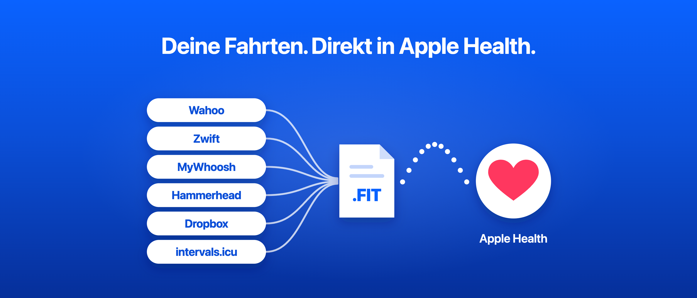
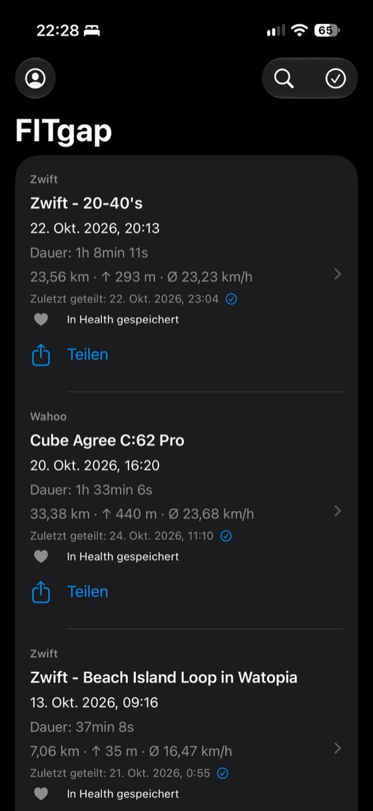
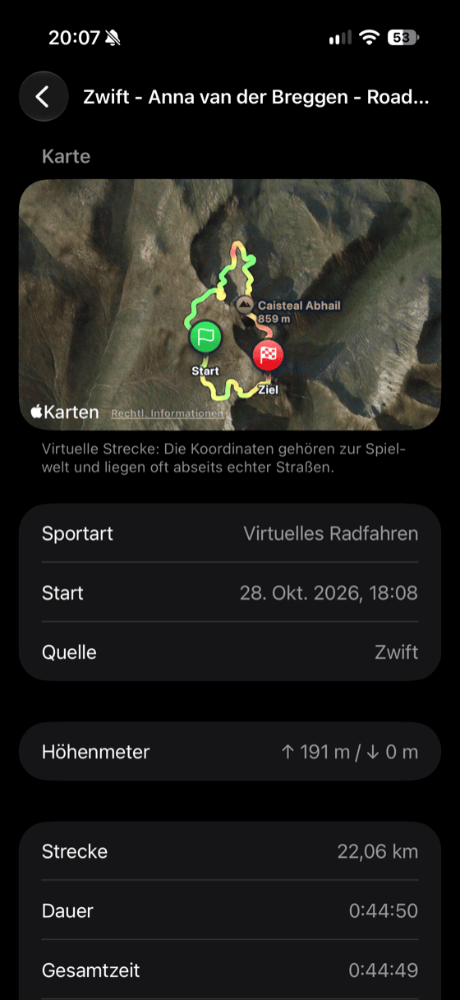
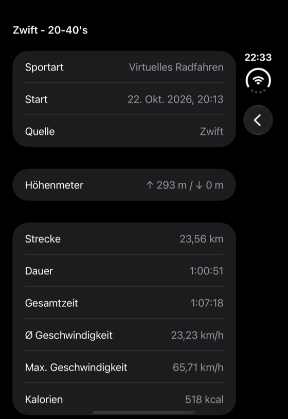
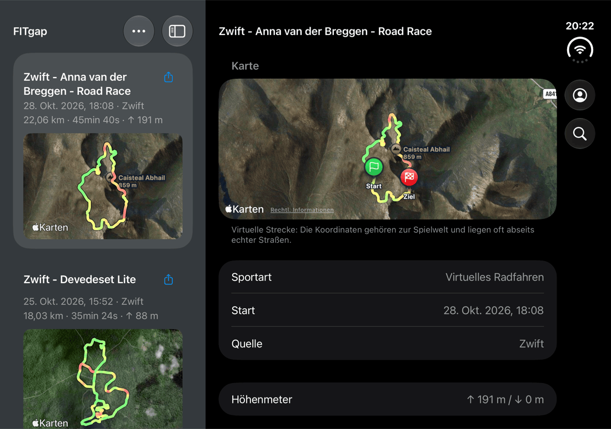

# FITgap

[English](README.md) · [Website](https://florianwildt.github.io/fitgap/) · [Datenschutzerklärung](https://florianwildt.github.io/fitgap/privacy/)



FITgap ist eine schlanke Open-Source-iPhone-App, die deine **Original-FIT-Dateien** von Wahoo, Zwift, MyWhoosh, Hammerhead und intervals.icu herunterlädt und über das native Share Sheet direkt an Apps wie [HealthFit](https://apps.apple.com/app/healthfit/id1202650514) übergibt. Die Dateien werden weder konvertiert noch neu kodiert.

- Ab iOS 17, SwiftUI mit nativen Bedienelementen
- Hell- und Dunkelmodus, deutsche und englische Oberfläche (nach iOS-Sprache, Englisch als Fallback)
- Zweispaltige Ansicht auf breiten Displays wie dem aufgeklappten iPhone Duo und im Querformat
- Kein Backend, kein Tracking, keine externen Abhängigkeiten

<p>
  
  
  
</p>
<p></p>

## Funktionen

- **Wahoo, Zwift, MyWhoosh, Hammerhead und intervals.icu:** Beliebige dieser Konten verbinden und alle Aktivitäten samt Original-FIT laden. Vorhandene Dateien werden bei späteren Abgleichen übersprungen. Über intervals.icu sind auch Fahrten von Garmin, COROS, Suunto, Polar und anderen Geräten abgedeckt.
- **Dropbox:** Lädt die FIT-Dateien, die Dienste wie Zwift, Wahoo ELEMNT, Karoo, Rouvy oder TrainerRoad automatisch nach `/Apps` in deiner Dropbox exportieren. Spätere Abgleiche holen nur Änderungen.
- **FIT-Dateien importieren:** `.fit`-Dateien aus der Dateien-App, Mail oder einer anderen App in FITgap öffnen oder mehrere direkt in der App auswählen, z. B. Exporte von Garmin, TrainerRoad, Rouvy, Bryton oder Karoo oder Dateien aus iCloud Drive, Dropbox oder Google Drive. Ungültige Dateien werden abgelehnt, eine schon vorhandene Datei kommt nicht doppelt hinzu. Importierte Aktivitäten durchlaufen Dublettenprüfung und Health-Export wie jede andere Quelle.
- **Dubletten:** Liefern mehrere Quellen dasselbe Training, zeigt die Liste nur die Kopie mit den meisten Messreihen und Kennzahlen; sie wird geteilt und in Health gesichert. Die übrigen Kopien bleiben gespeichert und stehen in den Details.
- **Teilen:** Eine FIT oder eine Mehrfachauswahl ans System-Share-Sheet übergeben, z. B. an HealthFit. Geteilte Aktivitäten werden in der Liste markiert.
- **Apple Health:** Aktivitäten als Trainings sichern, mit allen Messwerten, für die Health einen Typ hat (Herzfrequenz, Leistung, Trittfrequenz, Geschwindigkeit, Laufdynamik, Strecke, Energie, Schwimmbahnen), Runden, Pausen, Route und der Session-Zusammenfassung als Metadaten. Einzeln, per Auswahl oder automatisch für neue Aktivitäten. Bereits in Health vorhandene Trainings, von FITgap oder einer anderen App, werden erkannt und übersprungen.
- **Details:** Strecke, Dauer, Durchschnitts- und Höchstgeschwindigkeit, Herzfrequenz, Trittfrequenz, Leistung, Höhenmeter und mehr, lokal aus der FIT-Session gelesen.
- **Suche** über alle heruntergeladenen Aktivitäten.
- **Dateien-App:** Jede geladene FIT liegt zusätzlich unter *Auf meinem iPhone › FITgap*.
- **Große Archive:** Seitenweiser Abgleich mit Fortsetzung, Beachtung der Abruflimits von Wahoo und Dropbox und abbrechbare Downloads. Ab iOS 26 läuft ein selbst gestarteter Abgleich oder Health-Export nach dem Verlassen der App weiter, mit Fortschritt in der Dynamic Island.
- **Integrität:** Downloads werden atomar gespeichert und vor dem Teilen per SHA-256 geprüft.
- **Demo-Modus:** App ohne Konto mit drei synthetischen Beispielfahrten ausprobieren, auch den Export nach Apple Health. Zurücksetzen oder Beenden der Demo entfernt die Demo-Trainings wieder aus Health.

## Bauen und starten

1. `FITgap.xcodeproj` in Xcode öffnen, Scheme **FITgap** wählen.
2. Unter **Signing & Capabilities** das eigene Team wählen und bei Bedarf eine eigene eindeutige Bundle-ID setzen.
3. Simulator oder iPhone als Ziel wählen und ausführen.

Swift-Paket-Tests:

```bash
swift test
```

Schlüsselbund-, Sync-Lebenszyklus- und UI-Tests sind im Xcode-Scheme enthalten.

## Eigene Konten und API-Zugang

- **Wahoo** nutzt OAuth 2.0 mit PKCE (`fitgap://oauth/wahoo`, Scopes `user_read workouts_read`) und eine öffentliche Client-ID, kein Client-Secret. Die Client-ID steht in `Sources/FITgapCore/WahooOAuth.swift`. Für eine eigene Version im [Wahoo-Cloud-API-Portal](https://cloud-api.wahooligan.com/) eine eigene Anwendung registrieren und deren Client-ID und Redirect-URI verwenden.
- **Zwift** bietet keine öffentliche API. FITgap nutzt inoffizielle Schnittstellen mit einer öffentlichen Client-ID, die Zwift jederzeit ändern oder einschränken kann. Das Passwort wird nur vorübergehend zur Anmeldung verwendet und nie gespeichert.
- **MyWhoosh** bietet ebenfalls keine öffentliche API. FITgap meldet sich mit E-Mail und Passwort über die inoffizielle Schnittstelle der MyWhoosh-Apps an und speichert nur das Zugangstoken und die Kontokennung (`WhooshId`). Eine Token-Erneuerung ist nicht bekannt; nach Ablauf der Sitzung ist eine neue Anmeldung nötig. FIT-Dateien werden über signierte Downloadlinks ohne Zugangstoken geladen. MyWhoosh kann diese Schnittstelle jederzeit ändern oder einschränken.
- **Hammerhead** nutzt die offizielle API mit OAuth 2.0 (Scope `activity:read`). Hammerhead verlangt bei jeder Token-Anfrage ein Client-Secret und bietet kein PKCE, deshalb muss die App das Secret enthalten. Es kommt nie ins Repository: Es gehört in `Config/Secrets.xcconfig` (Vorlage `Config/Secrets.example.xcconfig`; Xcode Cloud schreibt die Datei in `ci_scripts/ci_post_clone.sh` aus der geheimen Umgebungsvariable `HAMMERHEAD_CLIENT_SECRET`). Beim Bauen maskiert `scripts/hammerhead-secret.sh` es mit einem pro Build neuen Zufallsschlüssel; das erschwert das Auslesen aus der App nur. Ohne Secret baut die App normal und blendet Hammerhead aus. Hammerhead akzeptiert nur http(s)-Rücksprungadressen, deshalb ist die statische Seite `docs/oauth/hammerhead/` auf GitHub Pages registriert; sie reicht Code und State an `fitgap://oauth/hammerhead` weiter und lädt nichts nach. Für eine eigene Version im Hammerhead Dashboard einen eigenen API-Client anlegen, diese Seite (oder eine eigene Kopie) als Rücksprungadresse eintragen und die Client-ID in `Sources/FITgapCore/HammerheadOAuth.swift` ändern.
- **Dropbox** nutzt die offizielle API v2 mit OAuth 2.0 und PKCE als öffentlicher Client (Rücksprung `db-<App-Key>://2/token`, das Schema, das Dropbox für Mobil-Apps vorsieht; `token_access_type=offline` für einen Refresh-Token), also ohne Client-Secret. FITgap fordert nur `files.metadata.read` und `files.content.read` an. Am wenigsten Zugriff bräuchte eine App mit *App folder*, sie sieht aber nur ihren eigenen Ordner unter `/Apps`, während Zwift, Wahoo, Karoo und andere in ihre eigenen Ordner dort schreiben. Deshalb braucht FITgap *Full Dropbox*, durch die beiden Scopes nur lesend; die App liest `/Apps` rekursiv, lädt nur `.fit`-Dateien und prüft jede vor dem Speichern gegen den Dropbox-Content-Hash und den FIT-Header. Der App-Key steht in `Sources/FITgapCore/DropboxOAuth.swift`; solange er leer ist, blendet die App Dropbox aus. Für eine eigene Version in der [Dropbox App Console](https://www.dropbox.com/developers/apps) eine App mit *Scoped access* und *Full Dropbox* anlegen, die beiden Scopes aktivieren, öffentliche Clients (PKCE) erlauben und den App-Key übernehmen; der Rücksprung ergibt sich daraus.
- **intervals.icu** nutzt die [offizielle API](https://intervals.icu/api-docs.html) mit deinem persönlichen API-Key (HTTP Basic Auth, Benutzer `API_KEY`) und deiner Athleten-ID, beides unter Settings › Developer Settings. Es gibt keine App-Registrierung und kein Client-Secret. FITgap lädt nur die Originaldatei (`/api/v1/activity/{id}/file`, gzip-komprimiert) und nur, wenn sie eine FIT ist; von Strava importierte Aktivitäten sowie GPX- und TCX-Originale werden übersprungen. Der Key läuft nicht ab; wird er bei intervals.icu neu erzeugt, endet der Zugriff von FITgap.

## Datenschutz

- Access- und Refresh-Tokens sowie der intervals.icu-API-Key liegen ausschließlich im lokalen Schlüsselbund (`WhenUnlockedThisDeviceOnly`, ohne iCloud-Synchronisierung).
- Aktivitäten und FIT-Dateien liegen auf dem Gerät unter `Application Support/FITgap/`. Es werden keine Daten an einen Server des Projekts gesendet.
- Der Zugriff auf Apple Health ist optional. FITgap schreibt Trainings und liest nur Trainings, um Duplikate zu erkennen; über FITgap verlassen keine Health-Daten das Gerät.
- Trennen entfernt die lokale Sitzung; die Freigabe beim Anbieter bleibt bestehen, nur bei Hammerhead und Dropbox widerruft FITgap sie. Heruntergeladene Dateien bleiben erhalten.

Siehe die vollständige [Datenschutzerklärung](https://florianwildt.github.io/fitgap/privacy/).

## Projektstruktur

| Pfad | Inhalt |
|---|---|
| `App/` | SwiftUI-App, Lokalisierung (`de.lproj`, `en.lproj`), Assets |
| `Sources/FITgapCore/` | Anbieterzugriff, Schlüsselbund, Speicher, FIT-Kennzahlenleser, Demo-Daten |
| `Sources/FITgapProbe/`, `Sources/WahooProbe/` | Kleine macOS-Kommandozeilenclients für API-Experimente |
| `Tests/`, `AppTests/`, `AppUITests/` | Paket-, iOS- und UI-Tests |
| `scripts/` | Hilfsskripte, z. B. `generate-demo-fit.py` für die synthetischen Demo-Dateien |
| `Assets/` | Marken- und App-Store-Grafiken |
| `docs/` | Projektwebsite (GitHub Pages) |

Die mitgelieferten Demo-FITs enthalten keine GPS-Koordinaten oder persönlichen Daten. Sie wurden synthetisch mit Garmins offiziellem Python-FIT-SDK erzeugt, das nur ein Entwicklungswerkzeug und keine App-Abhängigkeit ist.

## Mitwirken

Issues und Pull Requests sind willkommen. Mit dem Einreichen eines Beitrags stimmst du zu, dass er unter der Apache License 2.0 steht (Abschnitt 5 der Lizenz). Bitte Änderungen fokussiert halten und den vorhandenen Stil beibehalten.

## Lizenz

Lizenziert unter der [Apache License 2.0](LICENSE). Der Name **FITgap**, das Logo und das App-Symbol sind nicht von der Lizenz erfasst und dürfen nicht zur Kennzeichnung veränderter Versionen oder abgeleiteter Apps verwendet werden; siehe [NOTICE](NOTICE).

Die App-Store-Version ist eine bequeme, kostenpflichtige Fassung desselben Quellcodes. Du kannst die App jederzeit selbst bauen.

FITgap ist ein unabhängiges Projekt und steht in keiner Verbindung zu Wahoo, Zwift, MyWhoosh, Hammerhead, Dropbox, intervals.icu, Garmin oder HealthFit und wird von diesen nicht empfohlen.
