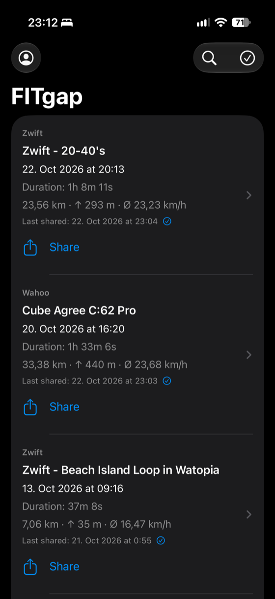
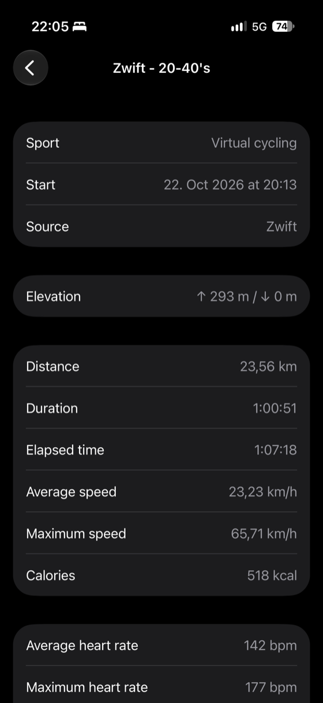
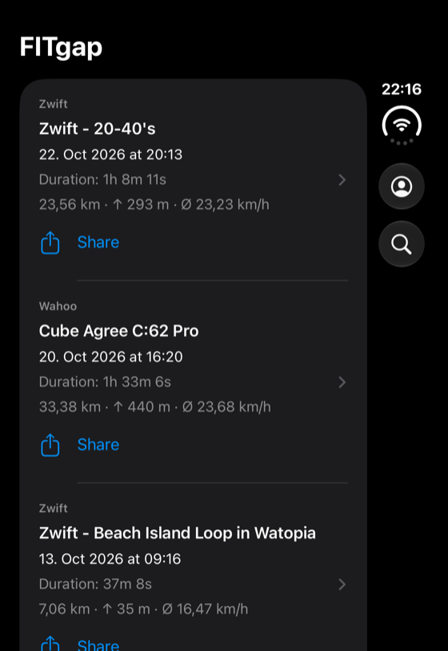
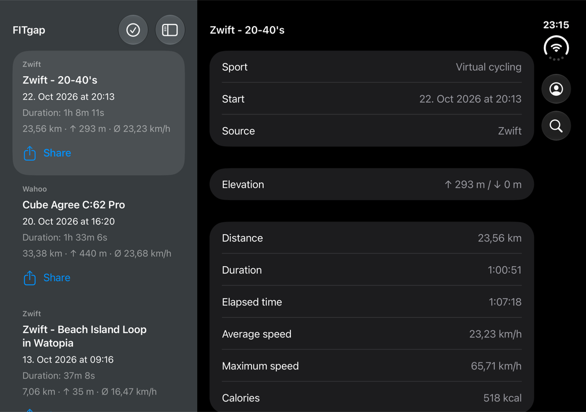

# FITgap

[English](README.md) · [Website](https://florianwildt.github.io/fitgap/) · [Datenschutzerklärung](https://florianwildt.github.io/fitgap-info/)


FITgap ist eine schlanke Open-Source-iPhone-App, die deine **Original-FIT-Dateien** von Wahoo und Zwift herunterlädt und über das native Share Sheet direkt an Apps wie [HealthFit](https://apps.apple.com/app/healthfit/id1202650514) übergibt. Die Dateien werden weder konvertiert noch neu kodiert.

- Ab iOS 17, SwiftUI mit nativen Bedienelementen
- Hell- und Dunkelmodus, deutsche und englische Oberfläche (nach iOS-Sprache, Englisch als Fallback)
- Zweispaltige Ansicht auf breiten Displays wie dem aufgeklappten iPhone Duo und im Querformat
- Kein Backend, kein Tracking, keine externen Abhängigkeiten

<p>
  
  
  
</p>
<p></p>

## Funktionen

- **Wahoo und Zwift:** Eines oder beide Konten verbinden und alle Aktivitäten samt Original-FIT laden. Vorhandene Dateien werden bei späteren Abgleichen übersprungen.
- **Teilen:** Eine FIT oder eine Mehrfachauswahl ans System-Share-Sheet übergeben, z. B. an HealthFit. Geteilte Aktivitäten werden in der Liste markiert.
- **Details:** Strecke, Dauer, Durchschnitts- und Höchstgeschwindigkeit, Herzfrequenz, Trittfrequenz, Leistung, Höhenmeter und mehr, lokal aus der FIT-Session gelesen.
- **Suche** über alle heruntergeladenen Aktivitäten.
- **Dateien-App:** Jede geladene FIT liegt zusätzlich unter *Auf meinem iPhone › FITgap*.
- **Große Archive:** Seitenweiser Abgleich mit Fortsetzung, Beachtung der Wahoo-Abruflimits und abbrechbare Downloads.
- **Integrität:** Downloads werden atomar gespeichert und vor dem Teilen per SHA-256 geprüft.
- **Demo-Modus:** App ohne Konto mit drei synthetischen Beispielfahrten ausprobieren.

## Bauen und starten

1. `FITgap.xcodeproj` in Xcode öffnen, Scheme **FITgap** wählen.
2. Unter **Signing & Capabilities** das eigene Team wählen und bei Bedarf eine eigene eindeutige Bundle-ID setzen.
3. Simulator oder iPhone als Ziel wählen und ausführen.

Swift-Paket-Tests:

```bash
swift test
```

Schlüsselbund-, Sync-Lebenszyklus- und UI-Tests sind im Xcode-Scheme enthalten.

## Eigene Konten und API-Zugang

- **Wahoo** nutzt OAuth 2.0 mit PKCE (`fitgap://oauth/wahoo`, Scopes `user_read workouts_read`) und eine öffentliche Client-ID, kein Client-Secret. Die Client-ID steht in `Sources/FITgapCore/WahooOAuth.swift`. Für eine eigene Version im [Wahoo-Cloud-API-Portal](https://cloud-api.wahooligan.com/) eine eigene Anwendung registrieren und deren Client-ID und Redirect-URI verwenden.
- **Zwift** bietet keine öffentliche API. FITgap nutzt inoffizielle Schnittstellen mit einer öffentlichen Client-ID, die Zwift jederzeit ändern oder einschränken kann. Das Passwort wird nur vorübergehend zur Anmeldung verwendet und nie gespeichert.

## Datenschutz

- Access- und Refresh-Tokens liegen ausschließlich im lokalen Schlüsselbund (`WhenUnlockedThisDeviceOnly`, ohne iCloud-Synchronisierung).
- Aktivitäten und FIT-Dateien liegen auf dem Gerät unter `Application Support/FITgap/`. Es werden keine Daten an einen Server des Projekts gesendet.
- Trennen entfernt nur die lokale Sitzung; die Freigabe beim Anbieter und heruntergeladene Dateien bleiben bestehen.

Siehe die vollständige [Datenschutzerklärung](https://florianwildt.github.io/fitgap-info/).

## Projektstruktur

| Pfad | Inhalt |
|---|---|
| `App/` | SwiftUI-App, Lokalisierung (`de.lproj`, `en.lproj`), Assets |
| `Sources/FITgapCore/` | Anbieterzugriff, Schlüsselbund, Speicher, FIT-Kennzahlenleser, Demo-Daten |
| `Sources/FITgapProbe/`, `Sources/WahooProbe/` | Kleine macOS-Kommandozeilenclients für API-Experimente |
| `Tests/`, `AppTests/`, `AppUITests/` | Paket-, iOS- und UI-Tests |
| `scripts/` | Hilfsskripte, z. B. `generate-demo-fit.py` für die synthetischen Demo-Dateien |
| `Assets/` | Marken- und App-Store-Grafiken |
| `docs/` | Projektwebsite (GitHub Pages) |

Die mitgelieferten Demo-FITs enthalten keine GPS-Koordinaten oder persönlichen Daten. Sie wurden synthetisch mit Garmins offiziellem Python-FIT-SDK erzeugt, das nur ein Entwicklungswerkzeug und keine App-Abhängigkeit ist.

## Mitwirken

Issues und Pull Requests sind willkommen. Mit dem Einreichen eines Beitrags stimmst du zu, dass er unter der Apache License 2.0 steht (Abschnitt 5 der Lizenz). Bitte Änderungen fokussiert halten und den vorhandenen Stil beibehalten.

## Lizenz

Lizenziert unter der [Apache License 2.0](LICENSE). Der Name **FITgap**, das Logo und das App-Symbol sind nicht von der Lizenz erfasst und dürfen nicht zur Kennzeichnung veränderter Versionen oder abgeleiteter Apps verwendet werden; siehe [NOTICE](NOTICE).

Die App-Store-Version ist eine bequeme, kostenpflichtige Fassung desselben Quellcodes. Du kannst die App jederzeit selbst bauen.

FITgap ist ein unabhängiges Projekt und steht in keiner Verbindung zu Wahoo, Zwift, Garmin oder HealthFit und wird von diesen nicht empfohlen.
