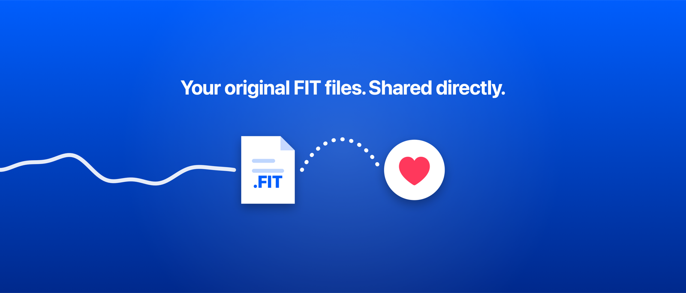
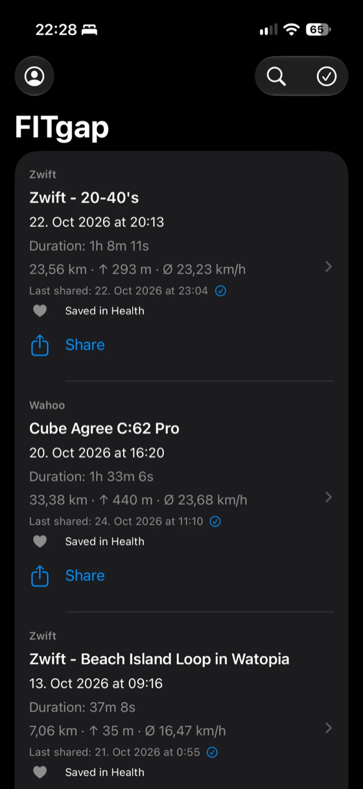
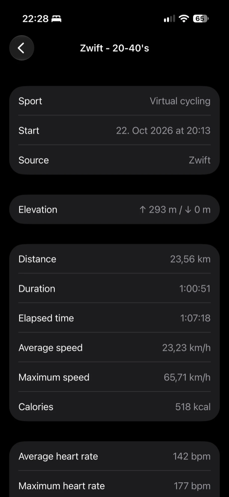
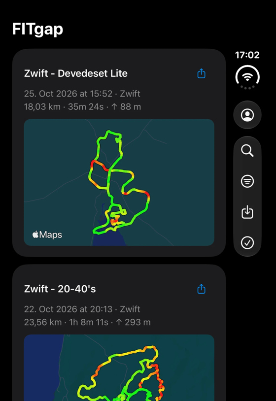
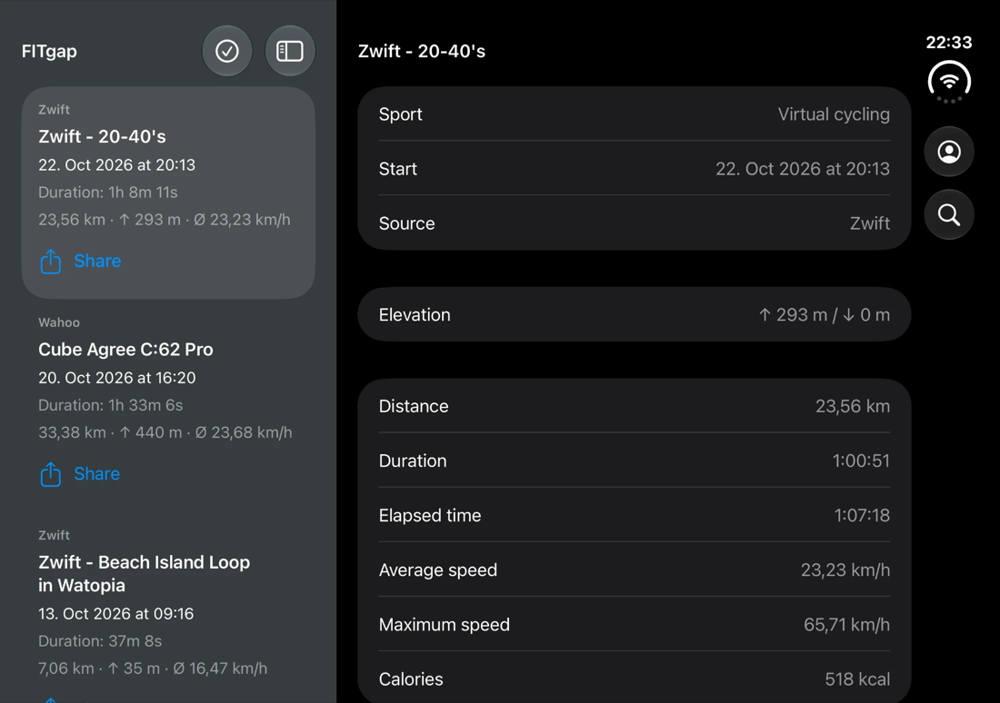

# FITgap

[Deutsch](README.de.md) · [Website](https://florianwildt.github.io/fitgap/) · [Privacy Policy](https://florianwildt.github.io/fitgap/privacy/en/)



FITgap is a small, open-source iPhone app that downloads your **original FIT files** from Wahoo, Zwift, MyWhoosh and Hammerhead and hands them directly to apps like [HealthFit](https://apps.apple.com/app/healthfit/id1202650514) through the native share sheet. Files are never converted or re-encoded.

- Requires iOS 17 or later, written in SwiftUI with native controls
- Light and dark mode, German and English interface (follows the iOS language, English as fallback)
- Two-column layout on wide displays such as the unfolded iPhone Duo and in landscape
- No backend, no tracking, no third-party dependencies

<p>
  
  
  
</p>
<p></p>

## Features

- **Wahoo, Zwift, MyWhoosh and Hammerhead:** Connect any of the accounts and load every activity with its original FIT file. Existing files are skipped on later syncs.
- **Duplicates:** When several sources deliver the same workout, the list shows only the copy with the most data streams and metrics; it is the one shared and saved to Health. The other copies stay stored and are listed in the details.
- **Share:** Hand one FIT or a multi-selection to the system share sheet, for example to HealthFit. Shared activities are marked in the list.
- **Apple Health:** Save activities as workouts with every record sample Health supports (heart rate, power, cadence, speed, running dynamics, distance, energy, swim lengths), laps, pauses, route and the session summary as metadata. Individually, by selection or automatically for new activities. Workouts already in Health, from FITgap or another app, are detected and skipped.
- **Details:** Distance, duration, average and maximum speed, heart rate, cadence, power, elevation and more, read locally from the FIT session summary.
- **Search** across all downloaded activities.
- **Files app:** Every downloaded FIT is also available under *On My iPhone › FITgap*.
- **Large archives:** Paged syncing with resume, respect for Wahoo rate limits, and cancellable downloads. On iOS 26 and later, a sync or Health export you started keeps running after you leave the app, with progress in the Dynamic Island.
- **Integrity:** Downloads are stored atomically and verified with SHA-256 before sharing.
- **Demo mode:** Try the app without an account using three synthetic sample rides, including the Apple Health export. Resetting or ending the demo removes the demo workouts from Health.

## Build and run

1. Open `FITgap.xcodeproj` in Xcode and select the **FITgap** scheme.
2. Under **Signing & Capabilities** choose your own team and, if needed, set your own unique bundle identifier.
3. Select a simulator or your iPhone and run.

Run the Swift package tests with:

```bash
swift test
```

The iOS keychain, sync lifecycle and UI tests are part of the Xcode scheme.

## Using your own accounts and API access

- **Wahoo** uses OAuth 2.0 with PKCE (`fitgap://oauth/wahoo`, scopes `user_read workouts_read`) and a public client ID, no client secret. The client ID is defined in `Sources/FITgapCore/WahooOAuth.swift`. If you build your own version, register your own application in the [Wahoo Cloud API](https://cloud-api.wahooligan.com/) portal and use its client ID and redirect URI.
- **Zwift** has no public API. FITgap uses unofficial interfaces with a public client ID, which Zwift may change or restrict at any time. Your password is only used transiently for sign-in and is never stored.
- **MyWhoosh** has no public API either. FITgap signs in with your email and password through the unofficial interface of the MyWhoosh apps and stores only the access token and your account ID (`WhooshId`). No token refresh is known, so an expired session requires signing in again. FIT files are fetched through signed download links without the access token. MyWhoosh may change or restrict this interface at any time.
- **Hammerhead** uses its official API with OAuth 2.0 (scope `activity:read`). Hammerhead requires a client secret for every token request and offers no PKCE, so the app has to carry the secret. It never enters the repository: put it into `Config/Secrets.xcconfig` (copy `Config/Secrets.example.xcconfig`; Xcode Cloud writes it from the secret environment variable `HAMMERHEAD_CLIENT_SECRET` in `ci_scripts/ci_post_clone.sh`). At build time `scripts/hammerhead-secret.sh` masks it with a random key per build; masking only slows down extraction from the app. Without a secret the app builds normally and hides Hammerhead. Hammerhead only accepts http(s) redirects, so the registered redirect is the static page `docs/oauth/hammerhead/` on GitHub Pages, which hands code and state to `fitgap://oauth/hammerhead` without loading anything else. For your own version, create an API client in the Hammerhead Dashboard, register that page (or your own copy) as redirect and change the client ID in `Sources/FITgapCore/HammerheadOAuth.swift`.

## Privacy

- Access and refresh tokens are stored only in the local keychain (`WhenUnlockedThisDeviceOnly`, no iCloud sync).
- Activities and FIT files are stored on the device in `Application Support/FITgap/`. Nothing is sent to a server operated by the project.
- Apple Health access is optional. FITgap writes workouts and only reads workouts to detect duplicates; no Health data leaves the device through FITgap.
- Disconnecting removes the local session; the authorisation at the provider remains, except for Hammerhead, where FITgap revokes it. Downloaded files remain.

See the full [Privacy Policy](https://florianwildt.github.io/fitgap/privacy/en/).

## Project layout

| Path | Contents |
|---|---|
| `App/` | SwiftUI app, localisation (`de.lproj`, `en.lproj`), assets |
| `Sources/FITgapCore/` | Provider access, keychain, storage, FIT summary reader, demo data |
| `Sources/FITgapProbe/`, `Sources/WahooProbe/` | Small macOS command-line clients for API experiments |
| `Tests/`, `AppTests/`, `AppUITests/` | Package, iOS and UI tests |
| `scripts/` | Helper scripts, e.g. `generate-demo-fit.py` for the synthetic demo files |
| `Assets/` | Brand and App Store artwork |
| `docs/` | Project website (GitHub Pages) |

The bundled demo FITs contain no GPS coordinates or personal data. They were generated synthetically with Garmin's official Python FIT SDK, which is only a development tool and not an app dependency.

## Contributing

Issues and pull requests are welcome. By submitting a contribution you agree that it is licensed under the Apache License 2.0 (section 5 of the license). Please keep changes focused and match the existing code style.

## License

Licensed under the [Apache License 2.0](LICENSE). The name **FITgap**, the logo and the app icon are not covered by this license and may not be used to identify modified versions or derived apps; see [NOTICE](NOTICE).

The App Store version is a convenient, paid build of this same source code. You are free to build the app yourself.

FITgap is an independent project and is not affiliated with or endorsed by Wahoo, Zwift, MyWhoosh, Garmin or HealthFit.
